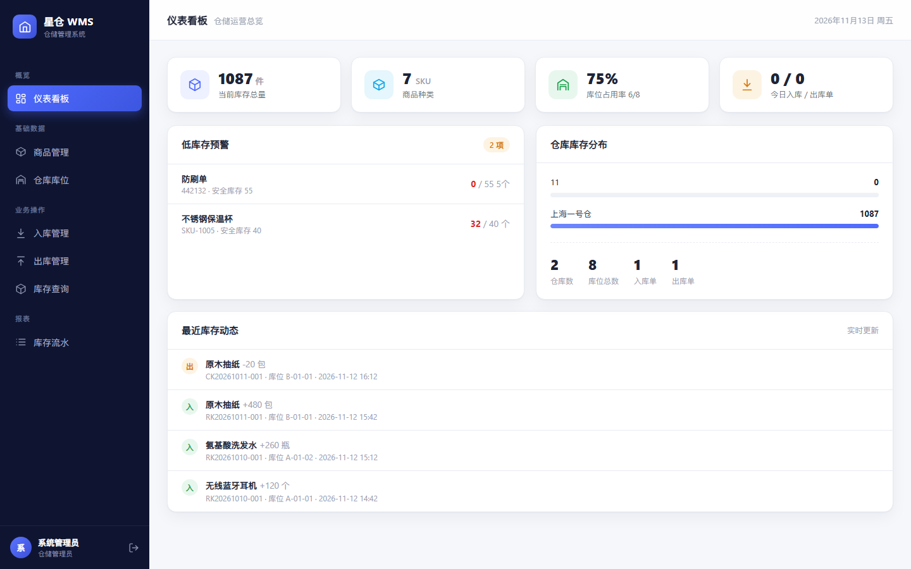
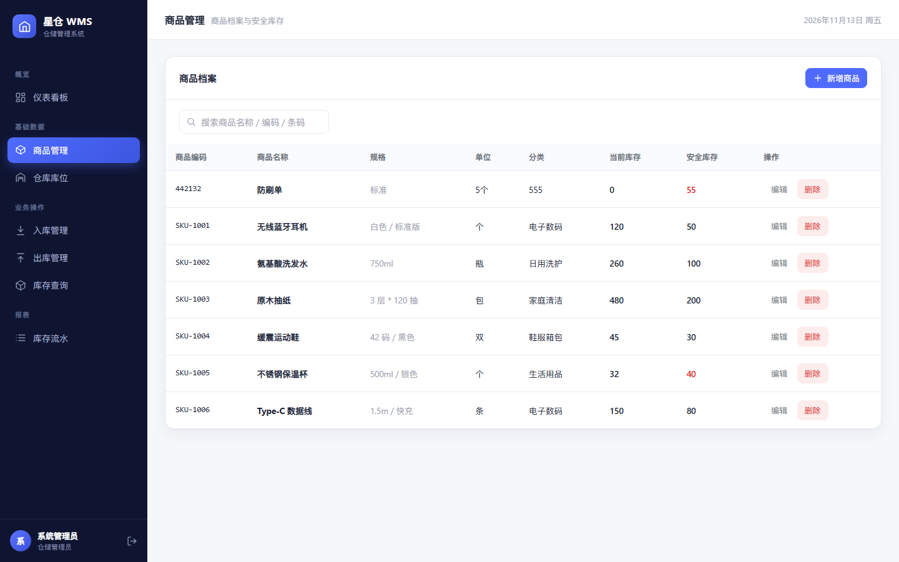
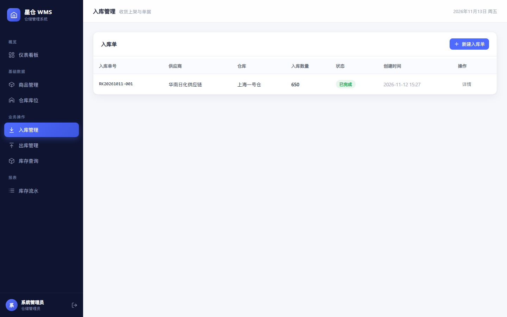
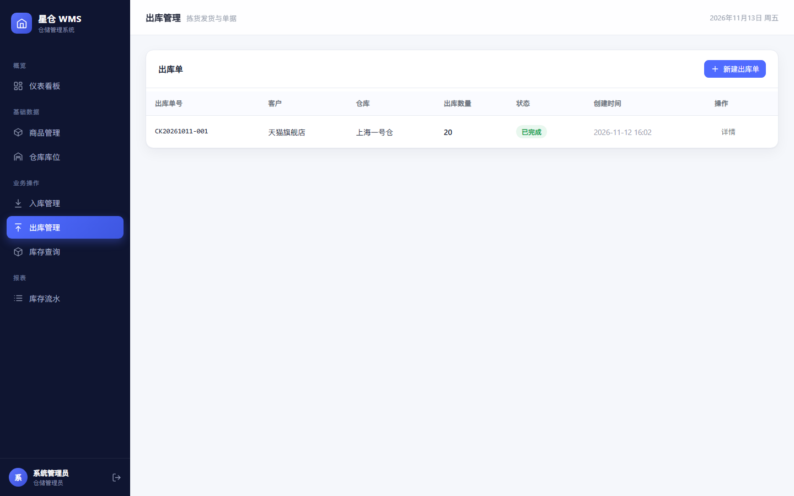
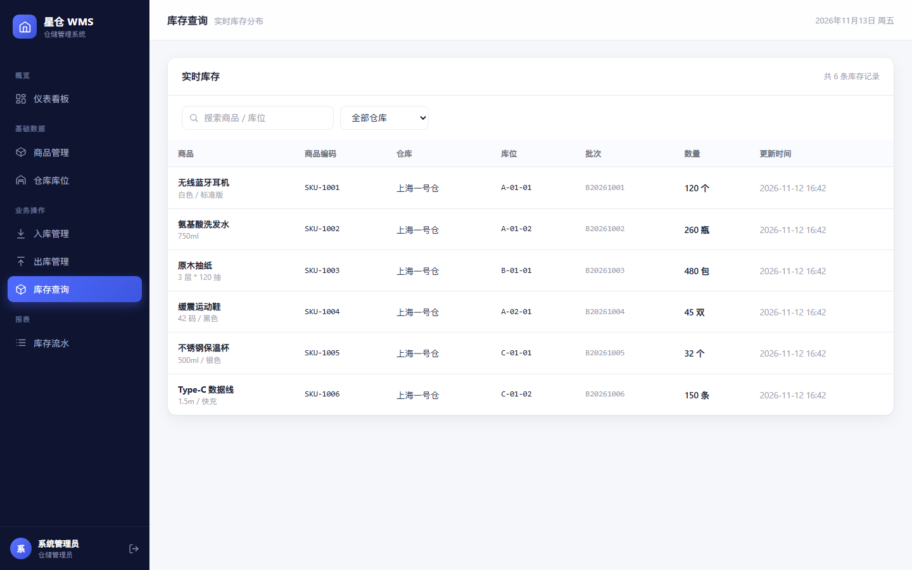
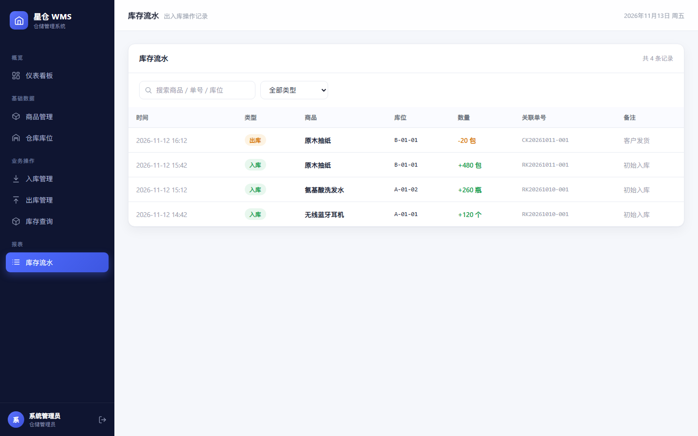
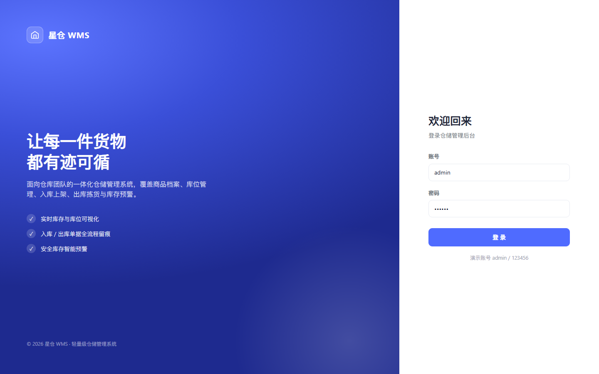

# 星仓 WMS · 物流仓储管理系统

面向仓库内部员工的仓储管理系统（WMS），覆盖商品档案、仓库库位、入库上架、出库拣货、实时库存与流水追溯。

后端已由 Node.js 迁移为 **Java（Spring Boot + MyBatis-Plus + MySQL）**，前端保持原生 JS 单页应用不变，由 Spring Boot 直接托管。

## 界面预览

| 仪表看板 | 商品管理 |
| :---: | :---: |
|  |  |

| 入库管理 | 出库管理 |
| :---: | :---: |
|  |  |

| 实时库存 | 库存流水 |
| :---: | :---: |
|  |  |

<details>
<summary>登录页</summary>



</details>

## 技术栈

| 层 | 技术 |
| --- | --- |
| 后端 | Java 17、Spring Boot 3.2、MyBatis-Plus 3.5、HikariCP |
| 数据库 | MySQL 8（应用启动自动建库建表、写入种子数据） |
| 前端 | 原生 JavaScript SPA、HTML / CSS、Hash 路由 |
| 鉴权 | Bearer Token + Spring MVC 拦截器 |

## 快速开始

环境要求：JDK 17+、Maven 3.9+、MySQL 8 已启动。

1. 复制 `config/local.example.yml` 为 `config/local.yml`，填入本机 MySQL 账号密码（该文件已被 `.gitignore` 忽略，不会提交）。
2. 启动：

```bash
mvn spring-boot:run
```

或打包后运行：

```bash
mvn -DskipTests package
java -jar target/wms-1.0.0.jar
```

访问 <http://localhost:3000>，默认账号 `admin / 123456`。

> 数据库 `wms` 会在首次启动时自动创建；`schema.sql` 建表、`data.sql` 写入演示数据（均为幂等语句，重复启动不会重复插入）。

## 工程结构

```
wuliu/
├── pom.xml
├── public/                     # 前端静态资源，由 Spring Boot 托管
│   ├── index.html
│   ├── style.css
│   └── app.js
├── src/main/java/com/xingcang/wms/
│   ├── WmsApplication.java
│   ├── common/                 # 统一异常、ID 生成
│   ├── config/                 # 鉴权拦截器、Token 存储、Web 配置
│   ├── controller/             # 9 个 REST 控制器
│   ├── service/                # 业务逻辑（库存一致性、单号生成等）
│   ├── mapper/                 # MyBatis-Plus BaseMapper + 注解 SQL
│   ├── entity/                 # 实体
│   └── dto/                    # 请求体
└── src/main/resources/
    ├── application.yml
    ├── schema.sql
    └── data.sql
```

## 核心业务逻辑

- **入库确认**：单据状态机（PENDING → COMPLETED / CANCELLED）约束下，按「商品 + 库位 + 批次」增加库存，并写入 `IN` 流水；已完成单据不可删除。
- **出库确认**：先按商品聚合需求量，校验目标仓库可用库存，不足直接拦截；充足则按库位库存从多到少自动分配拣货、扣减库存并写 `OUT` 流水，杜绝负库存。
- **单号生成**：`RK/CK + yyyyMMdd + 三位序列`，序列存于 `order_seq` 表，`INSERT ... ON DUPLICATE KEY UPDATE` 保证并发自增。
- **数据一致性**：确认操作整体 `@Transactional`，库存、流水、单据状态同事务提交。

## REST API

所有 `/api/*` 接口（除登录外）需携带 `Authorization: Bearer <token>`。

```
POST   /api/login                 登录
GET    /api/me                    当前用户

GET    /api/products              商品列表（?keyword=）
POST   /api/products              新增商品
PUT    /api/products/:id          更新商品
DELETE /api/products/:id          删除商品

GET    /api/warehouses            仓库列表
POST   /api/warehouses            新增仓库
PUT    /api/warehouses/:id        更新仓库
DELETE /api/warehouses/:id        删除仓库

GET    /api/locations             库位列表（?warehouseId=&keyword=）
POST   /api/locations             新增库位
PUT    /api/locations/:id         更新库位
DELETE /api/locations/:id         删除库位

GET    /api/inbound               入库单列表
POST   /api/inbound               新建入库单
POST   /api/inbound/:id/confirm   确认入库
POST   /api/inbound/:id/cancel    作废入库单
DELETE /api/inbound/:id           删除入库单

GET    /api/outbound              出库单列表
POST   /api/outbound              新建出库单
POST   /api/outbound/:id/confirm  确认出库
POST   /api/outbound/:id/cancel   作废出库单
DELETE /api/outbound/:id          删除出库单

GET    /api/inventory             实时库存（?productId=&warehouseId=&keyword=）
GET    /api/logs                  库存流水（?type=&keyword=&limit=）
GET    /api/dashboard             看板数据
```

## 与旧版 Node 后端的关系

仓库根目录仍保留旧的 `server.js` / `package.json`（零依赖 Node 实现，作为对照参考），当前生效的是 Java 后端，二者接口契约一致，前端无需改动。

## 后续可扩展方向

- 引入 Redis 缓存商品/库位字典与登录态
- 盘点单、调拨单、退货入库
- 批次 / 效期管理与先进先出（FIFO）
- 多仓库调拨与波次拣货
- 基于 DeepSeek 等大模型的智能补货建议与库存预测
